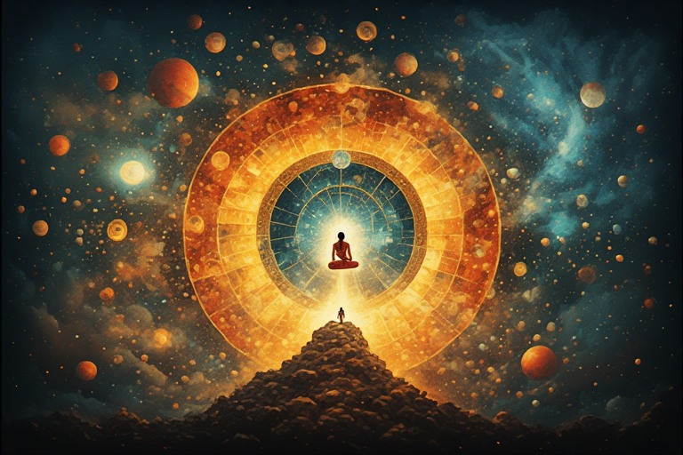



There is a strange thing that happens when you sit with Hindu cosmology seriously, not as mythology to be appreciated aesthetically, and not as superstition to be explained away, but as a body of theory — an attempt by exceptional minds, over centuries, to model the deepest structures of reality using the tools available to them.

What you find is not quaint pre-scientific speculation. You find something that converges, in remarkable ways, with what the most rigorous modern inquiry has independently arrived at. The timescales match. The structure of cycles matches. The understanding of life as a process of replication and complexity matches. The insistence that the universe has no beginning matches.

This convergence is either an extraordinary coincidence or it means something. The argument here is that it means something — and that understanding what it means changes how you look at the entire tradition.



## <u>The Problem with Scale</u>

The first obstacle is one of imagination. The yuga cycles of Hindu cosmology are almost incomprehensibly long. A full Mahayuga — one complete cycle of Satya, Treta, Dwapara and Kali Yuga — runs to 4.32 million years. A single Kalpa, one day of Brahma, contains a thousand such cycles. The numbers are so large that the natural human response is to treat them as mythological exaggeration, the kind of inflation that ancient traditions use to convey awe rather than describe reality.

But consider what they would actually mean if taken seriously. At this scale, the yuga cycles are not measuring human history. They are measuring something else. They are not tracking the rise and fall of kingdoms or the decline of morality within a recognisable civilisation. At millions-of-years timescales, you are measuring evolutionary time. You are measuring the lifespan of species, the emergence and extinction of biological forms, the deep time in which life on earth transforms beyond recognition.

Read this way, the yuga cycle is not a framework for understanding history. It is a framework for understanding evolution.

---

## <u>The Selfish Gene and the Primordial Ocean</u>

Richard Dawkins' *The Selfish Gene* offers a particular way of understanding life that, once encountered, is difficult to dislodge. The argument is this: in the primordial conditions of early earth, organic compounds formed and broke down constantly. Given enough time — hundreds of millions of years — random processes would inevitably produce compounds capable of self-replication. These replicators would compete for available resources. Better replicators would persist longer, replicate more accurately, and over time, the population of replicators would shift toward greater complexity and greater fidelity of reproduction.

Eventually, some replicators would develop protective structures around themselves — proto-cellular membranes. The bodies of every living thing on earth, from bacteria to human beings, are in this framework just vehicles: elaborate, evolved structures whose function is to carry and propagate the replicators inside them. What we call life is this process, endlessly iterating, over geological time.

The resonance with Hindu cosmology is striking enough to stop you.

The universe, in the Hindu framework, emerges from a single undivided reality — Brahman — and all manifested forms are temporary expressions of that same underlying substrate. Animals, plants, humans, all forms of life are the same essential thing taking different shapes. The primordial ocean, the waters from which creation arises, is that undivided substrate before differentiation. Everything that exists is a wave of the same ocean, rising and returning.

In the Dawkinsian model: all life shares the same replicating molecules, diverged from the same primordial chemistry, manifesting in endlessly different forms across evolutionary time.

The structures are the same. The primordial ocean and the primordial soup; the single source and the shared replicator; the endless cycling of forms and the endless iteration of natural selection. One arrived through ancient contemplative reasoning; the other through twentieth-century molecular biology. They describe the same thing.

---

## <u>The Dashavatara as Evolutionary Map</u>

The ten principal avatars of Vishnu, taken in sequence, trace a path that is startlingly coherent as an account of biological evolution.

Matsya, the fish — the beginning of vertebrate life in water. Kurma, the tortoise — the amphibious transition to land. Varaha, the boar — the fully terrestrial mammal. Narasimha, the man-lion — the transitional form, neither fully animal nor fully human. Vamana, the dwarf — the early, smaller hominid. Parashurama, the warrior — a more complete but still primitive human form. Rama, the ideal man — civilised, moral, integrated. Krishna, the complete human — philosopher, ruler, lover, god. Balarama and finally Kalki — the figure yet to come.

Read this sequence as evolutionary and it holds. Life begins in water, moves to land, passes through animal forms, transitions toward the human, and then moves through stages of human development toward something beyond what currently exists.

Modern biology can point at the genes and name the exact molecules involved. Ancient India produced this map through observation, analogy, and the kind of systematic theoretical reasoning that does not require electron microscopes to reach large conclusions. The knowledge that the earth is round, the heliocentric model of the solar system, the concept of zero — these were independently arrived at, lost, and rediscovered multiple times across human history. The capacity for correct theoretical inference about large structures does not depend on the instruments of modern science. It depends on the quality of the mind doing the inferring.

That Hinduism arrived at an evolutionary sequence through mythological form, rather than through genetics, does not make it less remarkable. It makes it more so.

---

## <u>Knowledge That Was Given, Then Lost, Then Given Again</u>

There is a moment in the Bhagavad Gita that tends to pass without sufficient notice. At the end of the discourse, having transmitted the entire content of what we now call the Gita to Arjuna, Krishna says: this same knowledge was given long ago — in earlier times — to Surya, the sun-god. Over time, it was lost. Now it is given again.

This is not an aside. It is a cosmological claim built into the structure of the text. Knowledge does not accumulate indefinitely. It peaks, is transmitted with difficulty across generations, and then is lost — either through catastrophe, or through the simple erosion of time and the difficulty of transmission. Then someone has to rediscover it, from scratch or from fragments, and the cycle continues.

This is precisely what the historical record shows, in domains ranging from astronomy to medicine to mathematics. Ideas are arrived at, inscribed, lost, recovered, re-arrived at by people who have not heard of the previous discovery. The heliocentric model was known to Aristarchus before Copernicus. The spherical earth was known long before it was forgotten in medieval Europe and then proved again. Ayurvedic knowledge about herbs and procedures is being rediscovered by Western medicine, often with great fanfare, as if for the first time.

This is not a criticism of modern science. It is a description of how knowledge actually travels through time — which is badly. The Gita's acknowledgement of this, embedded in the structure of the text itself, is one of the most sophisticated things about it.

The Vedic tradition did not only produce knowledge. It produced knowledge about how to transmit knowledge. The entire system of guru-disciple lineage, the oral transmission of Vedic texts with extraordinary attention to phonetic precision, the insistence on lifestyle as a prerequisite for understanding — eat minimally, live without unnecessary wants, practice brahmacharya, do dhyana — these are not merely ritual prescriptions. They are an epistemological system. They encode a theory about the conditions under which certain kinds of understanding become possible, and a method for producing those conditions in a student.

The knowledge and the method for accessing the knowledge were both given. This is an extraordinary achievement.

---

## <u>Sanatan Dharma as Universal Truth</u>

There is a way of understanding Sanatan Dharma that makes it something much larger than a religion, or even a civilisational tradition. The name itself makes the claim: eternal law, or more precisely, the truth that holds always and everywhere.

If this is taken seriously, it means that Sanatan Dharma is not the property of any people, geography, or historical period. It is the description of how reality actually is. Any sufficiently advanced civilisation, in any era, working with honest inquiry and enough freedom from material distraction, would arrive at the same conclusions. They might dress them in different languages, frame them in different stories, give the forces different names — but the underlying model would converge.

This is why the convergences with modern science are not surprising, on this reading. They are expected. The truth is not proprietary. It is observable by anyone who looks carefully enough.

It also means that the next iteration of this knowledge — the next civilisation that arrives at something like the complete picture — need not be Indian, or Hindu in any ethnic sense. It will be whoever has the material surplus to free minds from survival competition, the intellectual culture to take theory seriously, and the honesty to follow inquiry wherever it leads. India had these conditions during its long intellectual peak. Other civilisations have had them at other moments. Some are developing them now.

This is a more hopeful and more demanding frame than simple civilisational pride. It says: the goal is not the survival of one tradition or one people. The goal is the survival of the truth itself — and truth has survived worse losses than the current one.

---

## <u>The Puranas as Late-Night Conversations</u>

One more observation, smaller but illuminating.

The Puranas are structured as dialogues between sages. One asks; another answers. The conversation ranges widely, circles back, makes connections that are not always immediately obvious, and sometimes reaches conclusions that the participants themselves seem surprised by. The knowledge emerges through the dialogue rather than being delivered as a finished lecture.

This is not the form of a textbook or an encyclopaedia. It is the form of thinking-out-loud, of two minds working together on a problem larger than either could hold alone. The structure of the Puranas reflects the actual process by which the ideas in them were developed — not by one genius announcing his findings, but by sustained, probably late-night, probably wandering conversation between people who were genuinely trying to understand something.

The Vedas themselves are presented as shabd pramana — evidence from testimony, to be accepted initially on trust and then verified by one's own experience. Not because the tradition is authoritarian, but because the claim being made is that if you live in a certain way and practice in a certain way, you will arrive at the same understanding. The text is a prompt, not a conclusion. The conclusion has to be found again, personally, by each person who wants to have it.

This is a remarkable epistemological position: we can tell you what we found, and we can tell you how to get there yourself. But we cannot give it to you directly. You have to make the journey.

---

## <u>The End of This Cycle and the Next</u>

The Kali Yuga, in this framework, is not primarily a moral description of an era of wickedness. It is a description of a cognitive state: an age in which the truth is obscured, in which most people cannot see through the maya of immediate material reality to the deeper patterns underneath. An age in which perhaps one or two percent of the population, at any given time, has any real access to what is actually going on — and the rest are absorbed in the small competitions and narratives that feel urgent but are, against the background of evolutionary time, essentially noise.

The cycle ends not because someone fixes the civilisation, but because the chaos eventually consumes itself. The Kali Yuga does not improve and stabilise; it deepens until it cannot deepen further, and then the conditions for the next Satya Yuga begin to emerge from the wreckage. This is not optimism exactly, but it is not nihilism either. It is a very long-run view of what processes are actually in motion — one that makes the panics and catastrophes of any particular era look rather different.

The baton of accumulated understanding gets passed. Sometimes it is passed within one tradition, from teacher to student, across centuries. Sometimes it is dropped and someone else picks it up. Sometimes it is rediscovered entirely independently, by people who have never heard of the previous holder. What matters, from the perspective of the largest cycle, is that the truth survives — not that any particular people or tradition survive as its custodians.

This might be the most demanding thing Sanatan Dharma actually teaches. The eternal truth belongs to no one. It is available to everyone. And the responsibility of anyone who finds it is simply to pass it on as clearly as possible, in whatever form the next generation can receive it.

The rest, on the timescale of Yugas, takes care of itself.
