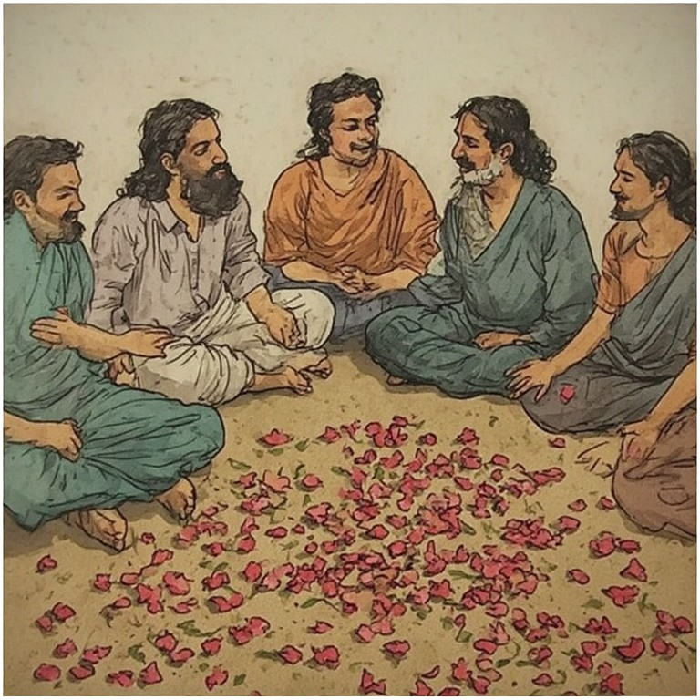



There is a version of the caste debate that almost everyone is having, and it is the wrong one. The question being asked is whether caste is a good or bad thing — morally, socially, historically. The question worth asking is simpler and more uncomfortable: ***why does it persist, and what have we actually replaced it with?***



## <u>Social Endogamy Is Not Unique to Caste</u>

Walk through any modern city and look at who marries whom. Corporate professionals marry corporate professionals. The salaried class clusters together. Families in finance produce children in finance. Athletes come from athletic households, and IITians' children navigate IIT with a naturalness that no classroom can manufacture. The environment, the vocabulary, the assumed ceiling — all of it is transmitted before any exam is written.

This is not a failure of the modern system. It is the system functioning exactly as social systems always have. The specialization of families is not a relic — it is a logic. A family that has practiced something for generations carries a form of knowledge that is genuinely difficult to replicate through formal instruction. The rich political families know this. They practice it without apology. The West, a young civilization still counting its first few centuries of continuity, has not felt this truth long enough to name it — but it is slowly being rediscovered there too.

The honest observation is that a specialized family consistently outperforms a generalized education. That is not a radical claim. It is what the data of lived experience has always shown.

## <u>The Democratic Promise, and Its Arithmetic</u>

The Ambedkarite reform project rested on a beautiful and intuitive idea: what separates a Brahmin from a Shudra is literacy and learning, and if we create a standardized path to that learning — a common curriculum, a common exam — anyone can walk it. Take the test, shed your past, become whoever you are capable of being.

The logic is clean. The execution has been something else.

For the vast majority of people, the promise of the open exam is precisely that: a promise, not an offer. Most people know, with reasonable accuracy, where they stand relative to competitive examinations. They are not being defeatist. They are being rational. What they actually want is stable, dignified work — work their families know, work they can do well, work that does not require them to first spend years mastering chemistry and physics they will never use again. The generalized curriculum — forced on every child through ten years of schooling — is not preparation for life. For ninety percent of the people who sit through it, it is the consumption of time that could have been spent developing actual competence.

The exam system serves a minority, and a specific minority: those capable enough to clear it and positioned well enough to try. For them, it is a genuine ladder. For everyone else, it is a distraction dressed as opportunity.

## <u>The Reservation Paradox</u>

One observation cuts through all of this with unusual clarity: nobody agitates for reservation in sweeping jobs. The demand is always for reservation in IIT, in medicine, in the civil services — the professions with the highest multipliers.

This is not a contradiction. It is a confession. The resentment is not fundamentally about caste identity. It is about the fact that modern economies have created a wildly unequal distribution of returns across professions. An AI researcher is not marginally more valuable than a cobbler — the gap is many orders of magnitude. This did not use to be true. When the gap between the most and least valuable professions was smaller, work was simply work. You did it, you lived, you had a life outside of it.

The moment that gap blew open, occupation became destiny in a way it had never quite been before. Everyone started wanting the high-multiplier professions — engineering, medicine, government — and everyone started resenting the barriers to them. The fixation on caste is, in significant part, a fixation on occupational inequality that is being expressed through the only vocabulary available.

## <u>What Was Lost Without Being Named</u>

Beyond the debate about mobility, something else has happened — something less visible and more consequential.

The old system, for all its rigidities, contained within it a class of people whose function was not to produce or trade or govern, but to think. To ask questions about how society ought to be organized, what the good life looked like, what obligations the powerful owed to the rest. This class drew its legitimacy from outside the market. It could not be bought, at least not easily, because its prestige did not depend on commerce.

That class has been dismantled without a replacement. What we have now is a society that has become thoroughly mercantile in its values — which is not inherently bad — but without the counterweight of an intellectual class that sits outside those values and can critique them. The merchant class, operating without that counterweight, is simply power. And naked power is easy to capture.

India's think tanks have largely been bought. Its intellectuals are hired for electoral campaigns rather than for governance. This is not incidental — it is structural. Democracy, by design, locates wisdom in the aggregate. It assumes that the collective judgment of the masses contains the answer to social questions. Having made that assumption, it has no mechanism to cultivate or patronize a class that might disagree with the masses. The monarchic system, for all its obvious failures, always maintained a model of intellectual patronage — thinkers were funded to think, not to win votes.

The result is a civilization that is commercially active but philosophically adrift. It has not figured out what it believes, so it cannot transmit belief. It is reacting rather than reasoning.

## <u>The Question of Civilizational Sequence</u>

The West presents an interesting mirror here. It developed science before it developed a philosophical framework adequate to contain science. It discovered extraordinary power over the material world without first deciding what that power was for. The Greeks and the Hindus did it in the other order — they asked the large questions first, and their answers gave them a framework within which tools had a place and a limit.

This sequencing matters. A civilization that develops capability before philosophy will eventually be controlled by its capability rather than directing it. The technology decides, and the humans rationalize. This is approximately where the West is now, and where India — having adopted the Western sequence — is heading.

True wealth, in the old sense, was not a dollar count. It was the condition of needing very little to live well, and owing nothing to anyone for what you had. A civilization organized around that idea produces very different institutions than one organized around maximum output. The former asks: *what is enough, and how do we protect it?* The latter asks: *how do we grow?* — and finds that it cannot stop asking.

## <u>Where This Leaves Us</u>

The caste debate is not really about caste. It is about the failure of a particular theory of society — the theory that generalized education, administered through standardized examinations, would dissolve inherited advantage and produce a genuinely open order. That theory has not worked. Inherited advantage persists. The outcomes follow the families. What has changed is that the old system, which at least named its hierarchies honestly and embedded within it the seed of an intellectual class, has been replaced with a new system that obscures its hierarchies behind the rhetoric of meritocracy and has no intellectual class to speak of at all.

The question is not whether caste endogamy is defensible. The question is whether what replaced it is better — and if so, for whom, and at what cost to everything else.

Those are questions worth sitting with. They do not have clean answers. But they are the right questions.
