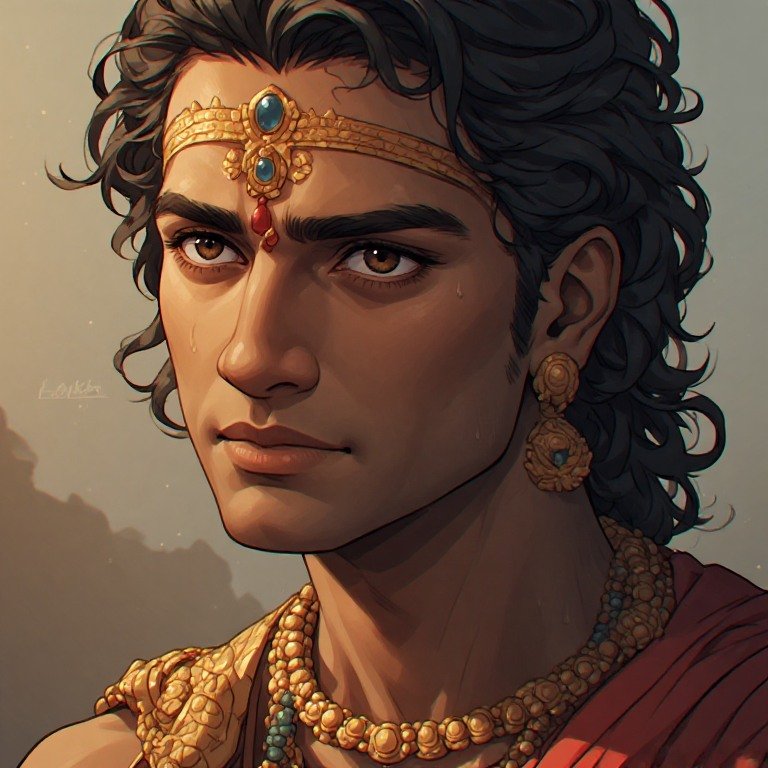


## <u>TLDR - Summary:</u>

> खड्गजिह्व धनुरास्यं शरदंष्ट्रं तरस्विनम् ।
> दृप्तं पुरुषशार्दूलं जहि कर्ण धनंजय ।।
>
> Karna is a lion among men — his tongue a blade, his open mouth a bow, his teeth like arrows; swift, and proud beyond measure. Strike him down, Arjuna.
>
> — *Mahabharata*, Karna Parva



Popular memory has been kind to Karna in a way the *Mahabharata* itself never quite is. In the epic's afterlife — in television serials, devotional retellings, and the general drift of sympathetic reinterpretation — he has become something close to a tragic hero: a man of low birth mocked by an unjust order, loyal to a fault, cursed by circumstance rather than choice. It is a compelling image, and not an entirely baseless one. But on the epic's own terms it is an incomplete one, and arguably a mistaken one. Read closely, Karna's story is not primarily about the injustice of caste. It is about something more universal and more uncomfortable: the ease with which a rigid, self-referential principle can be mistaken for dharma, and the extent to which even a capable, generous man can go wrong once he starts reasoning in only one dimension.

## <u>A Compromised Figure</u>

Long before he becomes a battlefield tragedy, the *Mahabharata* takes some care to ensure Karna is not read as blameless. It is Karna, in the assembly hall, who presses the argument that Draupadi, staked and lost at dice, has forfeited any claim to modesty in how she is treated — a position that turns a private humiliation into the spark of a war. It is Karna who, during the Kauravas' ill-advised expedition to gloat over the exiled Pandavas, is captured along with Duryodhana by a band of gandharvas and effectively leaves his patron to that fate, only for the Pandavas — the very cousins he has spent his life opposing — to ride out and free him. (Yudhishthira's reasoning for sending Arjuna on that rescue is itself instructive: whatever the five brothers' quarrels with the Kauravas, to the outside world they remain a single house of a hundred and five — a more capacious sense of loyalty than Karna himself ever quite manages.) And Karna's celebrated generosity — his famous refusal to turn away any petitioner, the charity for which he is still remembered — reads, in context, less like selfless virtue than like a man perpetually proving something to himself, a public performance of magnanimity that intensifies precisely when his pride has been wounded. Among the architects of the Kaurava cause, Karna is arguably the second-most consequential, after Duryodhana himself — more consistently a voice for war than even Shakuni, who is remembered as the arch-schemer but who, by some accounts, counselled Duryodhana at points to make peace and cede what the Pandavas were owed. Karna did not.

None of this makes Karna a simple villain. It only establishes that the epic does not hand him the moral high ground for free. Whatever tragedy attaches to him has to be earned against this record, not assumed in spite of it.

## <u>The Fourth Reason</u>

The clearest window into Karna's ethical architecture comes not on the battlefield but in a quiet, private conversation before the war, when Krishna — having failed to talk Duryodhana or Shakuni into peace — makes one last approach. He reveals to Karna what Karna apparently does not know with certainty: that he is Kunti's firstborn, elder brother to the Pandavas themselves, and invites him to claim that birthright and stand with his true kin. It is, among other things, a shrewd move — Karna is Duryodhana's single greatest asset, and his defection would hollow out the Kaurava cause before a single arrow is loosed.

Karna refuses, and gives four reasons. The first three are the ones a reader expects: he owes his upbringing to Radha, the mother who actually raised him, and will not now disown her for the birth-mother who once set him adrift; he has spent his life preparing for a single confrontation with Arjuna and will not surrender that ambition; and he is bound by gratitude to Duryodhana, who gave him status when the Kshatriya elite would not. These are recognisable human motives — loyalty, ambition, debt — and one can disagree with Karna's priorities while still understanding them.

The fourth reason is different in kind, and it is the one the tradition remembers as leaving even Krishna without a reply. By the strict logic of succession, Karna argues, Yudhishthira's claim to the throne is the just one. But if Karna now reveals himself and joins the Pandavas, he — as Kunti's actual eldest son — becomes the rightful heir in Yudhishthira's place; and since he is also bound in service to Duryodhana, custom would obligate him to hand that same throne straight back to the man he already serves. The outcome, Karna concludes, is unchanged either way. Better, then, to let matters run their course as Duryodhana's man than to unsettle everything for no net gain in justice.

## <u>The Flaw Inside the Argument</u>

It is worth sitting with why this argument feels so persuasive, because its persuasiveness is exactly the problem. It borrows the vocabulary of justice — rightful kingship, proper succession, the correct outcome — and uses that vocabulary to arrive at precisely the conclusion Karna already wanted on entirely different grounds. This is dharma reasoned backward. A more honest procedure would start from the question of what is just and let loyalty answer to it; Karna instead starts from a loyalty he has already decided is non-negotiable, and reverse-engineers a justice-shaped argument to protect it. That the argument also happens to let him keep his long-awaited duel with Arjuna and preserve his ties to the only father-figure who ever elevated him is not a coincidence worth ignoring. A conclusion that conveniently satisfies every one of a person's prior attachments deserves more suspicion, not less.

This is the precise sense in which Karna's dharma is self-made: not fabricated maliciously, but constructed from a single fixed point — his own bond of loyalty — treated as though it were the immovable axis around which everything else, including the welfare of a kingdom, must be made to turn.

## <u>The Truthful Man Who Was Sent to Hell</u>

The epic tradition does not leave this as an isolated case. A story told to the young Rama makes the same diagnosis from an entirely different angle. Before Rama's first real trial — killing the demoness Tadaka, who has been terrorising a forest of ascetics — he hesitates. To kill a woman offends a principle he holds as absolute. His teacher, the sage Vishwamitra, answers not with a command but with a story.

A certain ascetic, the story goes, spent his whole life speaking only the truth, in the confident expectation that such perfect honesty would earn him heaven. One day, villagers fleeing a band of dacoits begged him to mislead their pursuers. He would not lie even for this. When the dacoits arrived and asked which way the villagers had gone, he told them plainly, and the villagers were caught and killed. Years later, when the ascetic himself died, he was delivered not to heaven but to hell — to his genuine bewilderment, since he had never once broken his vow. He was told that his lifetime of "truth" had in fact been a private transaction: he had kept his own conscience spotless while making himself the instrument of other people's deaths. Guarding one's own virtue at the cost of a preventable harm to someone else, he learned, is itself a form of adharma.

The lesson Vishwamitra draws from this for Rama is usually given as the first article of raja-dharma, the ethics proper to a ruler: one's duty runs to the people who depend on one, not to the private purity of one's own conduct, and that duty can require setting aside even a rule as apparently sound as "do not harm a woman." The structure of the story is identical to Karna's, only inverted in content. The rishi's absolute is truth; Karna's is loyalty. In both cases, a single principle, followed without regard for its consequences to others, produces an outcome its holder never intended and cannot excuse himself from. Both stories are, in effect, the same warning delivered twice: a dharma that never looks up from its own axis is not yet dharma. It is only a slogan with good posture.

## <u>What the Serials Left Out</u>

It is against this background that the modern rehabilitation of Karna as caste-martyr looks thinner than it is usually given credit for. The version popularised by television retellings holds that Karna was persecuted for low birth — mocked, excluded, denied his due because he was raised in a charioteer's household. The textual tradition tells a more complicated story. Karna's own birth is not low at all: he is the son of a Kshatriya princess, and the household that raised him, the Suta lineage, was a recognised — if socially ambiguous — station within the old order, not a condition of servitude; other men of Suta background are remembered in the tradition as kings in their own right, intermarrying without incident into Kshatriya lines. What Karna suffered at the hands of the Kuru elite reads less like structural oppression and more like the ordinary, ugly snobbery of a closed aristocratic circle protecting its own status — genuinely painful, but a different phenomenon with a different lesson.

The much-dramatised episode of Karna's ten-day exclusion from the fighting receives similar simplification. It is often staged as a caste bar, Bhishma refusing to let a low-born man fight among his betters. What the tradition actually records is narrower and, in its way, more human: asked by Duryodhana to rank the great warriors of both armies, Bhishma simply declined to count Karna among the foremost — a professional judgment, not a caste ruling — and Karna, stung, swore not to fight until Bhishma was gone. It is a story about wounded pride answering a professional insult with a grudge, not a story about systemic exclusion.

Even Karna's reputation as a warrior without peer softens under scrutiny: the tradition also records his defeats, more than once, at the hands of Arjuna, Bhima, Yudhishthira, and even the young Abhimanyu. His genuine and considerable virtue was not invincibility but persistence — a refusal to stay beaten, a willingness to re-enter the field after every fall. It is a smaller, more human virtue than the myth allows him, and arguably a more admirable one.

The same one-dimensional logic recurs, tellingly, in the man Karna served. Duryodhana goes to war partly on the strength of Karna's private assurance that he alone can hold off Arjuna — a promise from a man who has already, once, failed and abandoned him, and who will go on to lose to him repeatedly. Duryodhana believes it anyway, for the simple reason that he wants war regardless of the evidence: he takes Shakuni's counsel wherever it points toward conflict and sets it aside wherever it points toward peace. Even Bhishma's participation, fighting to the end for a cause he privately regards as unrighteous, rests on nothing more examined than the fact that Duryodhana is his king. The court Karna keeps is one in which almost everyone has, in their own way, stopped asking dharma to justify their loyalties and started asking their loyalties to stand in for dharma.

## <u>Two Judgments</u>

There is a final scene worth setting beside all this, not because it resolves the argument but because it rhymes with it. After death, Yudhishthira is shown a heaven that contains Duryodhana and, going in search of his own brothers, is shown instead a hell in which he believes they suffer. He refuses the reward on the spot, choosing to share his brothers' punishment over an undeserved comfort — only then to learn that the whole vision was a test, an appearance staged for his judgment, and that the Pandavas had been in heaven all along.

It is a fitting note to end on, because it restates the same instruction in a different key: the first thing shown is not to be trusted as the last word. A grieving man in heaven and suffering brothers in hell turn out to be a trial of perception, not a verdict. So, in its own way, does Karna. The wronged, loyal, tragic figure offered up by first impression — and now by popular retelling — is the same kind of appearance: emotionally available, morally comfortable, and not quite what survives closer reading. What the *Mahabharata* actually renders, examined past that first impression, is a portrait of a capable and not unsympathetic man undone by the oldest ethical error available to capable men: mistaking the principle he could not bear to abandon for the dharma he was obliged to serve.
