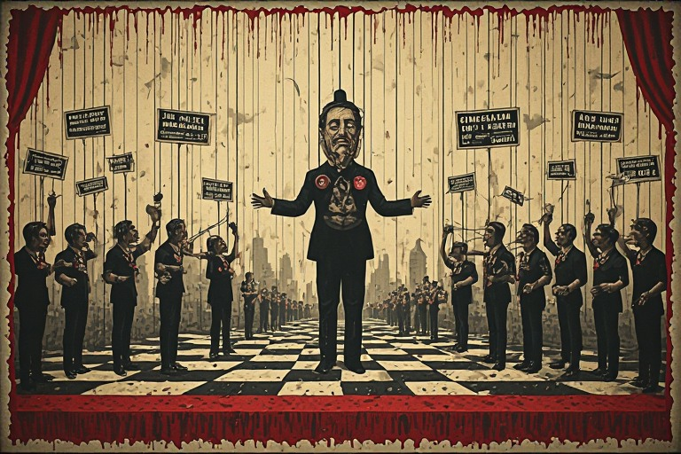



There is a kind of social engineering so elegant that it requires almost no maintenance once set in motion. No ongoing conspiracy, no shadowy coordination, no continuous effort from whoever designed it. It just runs. The genius of it is that the very people it is used against become its most reliable operators.

Understanding how this works requires setting aside the usual framework of oppressor-and-oppressed narratives, and instead looking at the mechanism underneath them — the actual lever being pulled and why it never stops moving.



## <u>The Founding Trick</u>

The basic trick is simple enough to state in one sentence: tie material benefit to a narrative of grievance, and that narrative becomes immortal regardless of whether it is true.

Once a community's access to resources — reservations, welfare, political representation, social status — is structurally dependent on the story that they were wronged by some other group, the community will defend that story with everything they have. Not because they are dishonest, and not necessarily because they are wrong about the history. But because the story now feeds them. To abandon it is to abandon the material claim that rests on top of it.

This is not a cynical observation about any particular group. It is a description of normal human behaviour under the conditions that have been engineered. Any community, given the same incentive structure, would do the same. You could apply this to any sub-group within almost any large society, set up the same welfare dependency around a specific victim narrative, and watch the same thing happen. The narrative would become self-defending. Those benefiting from it would expand its definitions over time, invent new instances of the original grievance, and police anyone who questions it — all without any outside instruction to do so.

The conditions, once established, produce the behaviour automatically.

---

## <u>Why the Lie Doesn't Need to Be True</u>

The striking thing about these narratives is that their truth-value is almost irrelevant to their longevity.

A narrative needs to be true enough to take initial hold — it needs some founding legitimacy, some historical basis, some early intellectual framing that gives it credibility. James Mill, who wrote his *History of British India* without ever setting foot in the country, provided exactly this for the colonial framing of Indian civilisation. His book — essentially a sustained moral indictment of Hindu society — was made required reading for every British official posted to India. It seeded every administrator with the same interpretive lens before they arrived, ensuring that whatever they observed would be filtered through his conclusions.

But once a narrative is embedded, once it has been institutionalised and once livelihoods depend on it, its truth no longer matters. You can disprove it a thousand times. The community sustaining it will find new formulations, expand the definition of the original harm, discover subtler and more diffuse forms of the grievance. This is not bad faith — it is the natural response of people who have been placed in a position where questioning the narrative threatens something real in their lives.

What keeps the narrative alive is not evidence. It is usefulness.

---

## <u>The Self-Perpetuating Design</u>

Look at how this plays out structurally. The target community — the one designated as having been oppressed — cannot be fully integrated into the larger society's project without giving up the narrative. But giving up the narrative means giving up the material entitlements attached to it. So they never fully integrate. They remain in a permanent posture of grievance, one eye always on the claim, always needing the oppressor to remain a little guilty, always needing the religion or the caste or the gender or the race of the supposed oppressor to remain a little tainted.

This creates a remarkable secondary effect. The supposed oppressor group — the one made guilty by the narrative — can never be fully defended either, even by its own members who care about it. Consider how this works for those who genuinely care about Hindu civilisation and want to protect it. They face a community within their own ranks that will not abandon the caste oppression narrative because that narrative has a material payoff. So the defenders of Hinduism end up constantly reformulating their own tradition to accommodate the narrative — claiming caste was always karma-based, never hereditary; blaming only one sub-group within the tradition; insisting the rest is unblemished. They shape-shift the tradition endlessly to try to preserve it while keeping one foot in the lie.

The tradition keeps reforming itself around the wound that has been placed inside it. And the wound never closes, because closing it would end someone's income.

This is the genius of it. You do not need a permanent external enemy. You seed a structure that creates permanent internal enemies. The community does the work of dividing itself.

---

## <u>It Was Never Only India</u>

The same structure runs in gender politics. The feminist narrative of wholesale female oppression across all classes and all of history does not survive basic scrutiny — noble women were not worse off than peasant men; the experience of class and the experience of sex have always intersected in ways that make blanket claims incoherent. But the incoherence does not matter. Once state benefits, workplace protections, and social prestige become attached to the narrative of women as oppressed class, women have a structural incentive to maintain that framing. They may love the men in their lives. They may not privately believe in the cartoon version of patriarchal oppression. But some level of male guilt must be preserved, because the entitlements rest on it.

The same logic runs in racial politics. It ran in the colonial project's installation of Marxist and class-war frameworks into colonised societies — British correspondence from India makes clear that this was deliberate, not accidental. The divide was engineered by giving intellectual legitimacy to internal fractures and then walking away. The locals could be trusted to run it themselves.

Wherever you look, the mechanism is identical: designate an oppressor group, tie resources to the designation, and let human nature do the rest.

---

## <u>Democracy as Accelerant</u>

This is where the structure becomes particularly difficult to dismantle, because democracy does not neutralise it — democracy amplifies it.

In a democracy, every grievance bloc has electoral weight. Every community with a narrative of victimhood has votes to deliver. The system therefore rewards politicians who sustain these narratives and punishes those who challenge them. The deeper the division, the more stable the political market for managing it. Parties need the oppressed group to remain oppressed enough to keep voting as a bloc. The incentive structure of democratic politics runs perfectly parallel to the incentive structure of the grievance narrative itself.

This is why the global spread of universal suffrage — pushed especially hard in the post-colonial world — fits so neatly with the simultaneous export of identity-grievance politics. Democracy, in societies where these narratives have been seeded, does not resolve the divisions. It institutionalises them. Every election becomes a mobilisation of the wound.

And once the state itself becomes the machine for managing grievance — once the government is the body that decides which groups are oppressed and distributes resources accordingly — the loop is complete and self-sustaining. There is no external force required. The state, the beneficiary communities, the political parties, and the expanding definition of oppression all maintain each other indefinitely.

---

## <u>The Near-Insolubility of It</u>

What makes this structure remarkable is not its scale, but its near-insolubility once established.

The most obvious hope would be material prosperity: if everyone is wealthy enough, the resource competition underlying the narrative might lose urgency. But this does not hold. Even among the most materially comfortable societies, the grievance structure continues to intensify. The definition of oppression expands to fill the space available. When outright discrimination disappears, implicit bias is discovered. When implicit bias is addressed, systemic structures are indicted. The bar never rests.

This is not a failure of prosperity. It is the mechanism continuing to work as designed. The goal was never to solve a problem — it was to create a permanent condition.

The only thing that genuinely disrupts it is when the mechanism becomes visible enough that even the people benefiting from it can see what they are doing. This requires a level of collective honesty and security that is very hard to produce at scale. It requires the beneficiary community to trust that their legitimate material needs can be met through some arrangement other than the narrative — which means it requires an alternative to be credibly on offer.

Short of that, the realistic path is through some kind of rupture. Divides this structurally embedded do not dissolve through persuasion. They tend to outlast persuasion and wait for a harder resolution.

---

## <u>What This Names</u>

What this framework describes is not, ultimately, a story about any particular group's malice or any particular community's weakness. It is a description of a system interacting with human nature at its most predictable — the tendency to protect what feeds us, to maintain the story that justifies what we need.

The people who designed these structures understood this. They did not need the beneficiaries to be dishonest or stupid or uniquely susceptible. They only needed them to be normal.

That is what makes it hard to be angry at the individuals caught inside it, and what makes it worth being very clear-eyed about the structure itself. The trap runs itself. The only question is whether enough people, at any given moment, can see that they are inside it.
