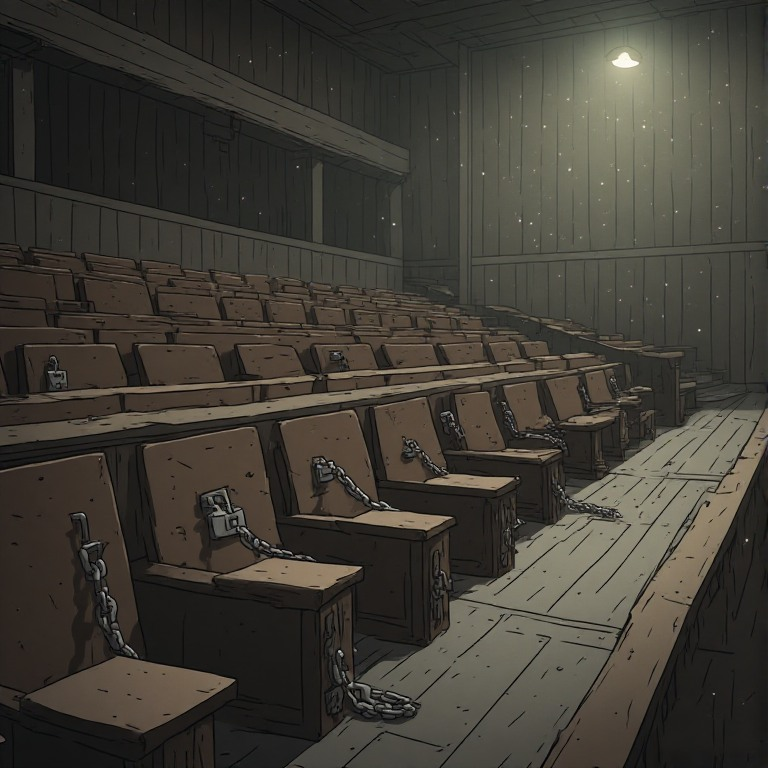



Reservation in India was supposed to be temporary. That was the promise — a brief constitutional correction, a decade-long transition to lift the historically marginalized, after which the Republic would move toward equal citizenship. Seven decades later, the transition has not ended. It has expanded.

The question of why it endures is usually answered with moral arguments — about justice, historical suffering, social equity. These are the terms the debate is conducted in. They are also the reason the debate never resolves. Because the real answer is not moral. It is structural. Reservation endures because of how democracy itself works — and understanding that mechanism reveals why the arguments against it, however sound, have failed to dislodge it, and what would actually need to change for that to happen.



---

## <u>Democracy Runs on Consensus, Not Reason</u>

Start with the mechanism. Democracy does not run on reason. It runs on consensus. And consensus does not require being right. It requires being organized.

This is not a critique. It is a description of how the machine works. At its core, democratic power is arithmetic: you gather people who already want to believe what you will tell them, you reinforce their shared story, and you act together. You do not need to convince your opponents. You do not even need to engage them. You simply need to consolidate your own side and show up in numbers.

The groups that have secured and expanded reservation understand this instinctively. They do not waste time debating their detractors or constructing careful, falsifiable arguments for why the policy should continue. They tell their own people a story — about suffering, about entitlement, about what is owed to them — and they repeat it relentlessly. The story does not need to survive five minutes of scrutiny from an outsider. It does not need to be true. It needs to be *believed by the bloc*. Once the bloc believes it, the story has done its work. Outsiders may find it absurd or fabricated, and it does not matter even slightly.

This is not a bug in the system. It is the system working exactly as designed. Democracy does not ask whether your position is logical. It asks whether you can build consensus around it. And consensus can be built on anything — grievance, resentment, aspiration, even pure fiction. The only requirement is cohesion.

---

## <u>The Bloc That Organizes vs. The Bloc That Reasons</u>

Here is where the reservation debate becomes instructive about something larger.

On one side, you have groups that mobilize with breathtaking ease. A caste cluster demands additional reservation, occupies streets, disrupts public life — and receives what it asks for, sometimes within weeks. They do not agonize over whether their demand is fair. They do not pause to consider the opposing perspective. They do not feel the need to justify themselves to anyone outside their bloc, because they do not respect the people outside their bloc enough to care what they think. There is a raw, unapologetic self-interest at work — and it is extraordinarily effective.

On the other side, you have the groups that bear the costs of reservation — the general category, locked out of 60% of seats in education and public employment. Their grievances are real and mounting. But they cannot mobilize. Not because they lack cause, but because they are trapped in a thicket of self-doubt, self-critique, and a compulsive need to be reasonable. Before they can make a demand, they need to establish that the demand is morally justified. Before they can organize, they need to be certain they are not in the wrong. They concede ground in advance — agreeing that historical suffering was real, that discrimination existed, that the other side has a legitimate claim — and in doing so, they have already lost the argument before opening their mouths.

This is the central asymmetry of the reservation debate. One side operates on pure self-interest. The other operates on a need for moral legitimacy. In a democracy that rewards consensus rather than correctness, self-interest wins every time.

There is something baked into this — a tendency to turn inward, to question oneself before questioning the opponent. Call it a cultural reflex. It manifests as an almost pathological need to find fault in one's own position, to steelman the other side, to seek a "reasonable solution." But democracy does not reward reasonableness. It rewards conviction. And conviction does not require being right.

---

## <u>The Trap of Conceded Ground</u>

Every time the opponents of reservation concede that the other side's claims are valid — even partially, even grudgingly — they chip away at their own capacity to organize. This is not an abstract point. It plays out concretely in the debate.

Take the foundational claim that historical suffering justifies present-day entitlements. These claims are, at minimum, far more contested than popular discourse acknowledges. The evidence is thinner than assumed, the narratives more constructed than discovered. But the moment someone concedes — even to "look good," even to avoid social friction — they have granted the foundational premise of the entire political project behind reservation. Once the premise is conceded, the demand follows naturally. You have already agreed to the story; you are now just haggling over the price.

This is why the instinct to be reasonable is not a virtue in democratic combat. It is a vulnerability. Every concession is ammunition for the other side. Every acknowledgment of fault weakens your bloc's cohesion. And cohesion — not correctness — is what produces political outcomes.

---

## <u>The Ambiguity Engine</u>

Consider the design of reservation policy itself. There is no clarity on who gets it, for how long, or what exactly it is meant to achieve. Was it intended as a temporary measure to correct a specific historical wrong? If so, when does the correction end? What would success even look like — what measurable benchmark would signal that the policy has fulfilled its purpose and can be withdrawn? Was it meant to be permanent? If so, on what principled basis?

The ambiguity is not an oversight. It is the feature. If the architects of the policy had openly stated that these entitlements would last for a thousand years, nobody would have accepted it. The vagueness — the lack of a defined endpoint, the absence of measurable success criteria — is precisely what allows the system to perpetuate itself indefinitely. Ambiguity is the medium in which reservation swims. Remove the ambiguity and the whole structure becomes negotiable. Keep it opaque and no one can pin down when, or whether, the commitment has been fulfilled.

This is a broader pattern. Policies that survive are not the ones with the strongest justification. They are the ones that are hardest to challenge — wrapped in enough vagueness, emotional weight, and political inertia that dislodging them costs more than anyone is willing to pay.

---

## <u>The Economic Reframe Trap</u>

A common impulse among those who oppose caste-based reservation is to propose an economic alternative — shift the basis from caste to income. It sounds reasonable. It sounds fair. And it is political suicide.

Here is why. The moment you accept the framework of reservation and merely argue for a different criterion, you have already conceded the core mechanism. You have agreed that 60% of seats can be locked away from open competition; you are just negotiating which 60%. The structural problem — that a majority of opportunities are reserved for blocs that organize politically — remains entirely untouched.

Worse, the economic reframe fragments your own potential support. The moment you introduce an income cutoff, everyone above that cutoff loses interest. The creamy layer — set at a level that captures a wide swath of the middle class — ensures that anyone who is not genuinely struggling has nothing to gain and therefore nothing to fight for. You have taken a group that already struggles to cohere and given them a reason to disengage. The bloc you needed to build dissolves before it forms.

The lesson is simple: accepting your opponent's framework and trying to modify it is not compromise. It is surrender with extra steps.

---

## <u>Necessity, Not Argument</u>

If argument worked, reservation would have been reformed decades ago. The arguments against the current arrangement are not obscure — they are obvious, abundant, and available to anyone willing to spend five minutes thinking. The problem has never been a deficit of arguments. The problem is that arguments do not mobilize people. Necessity does.

People do not act because they have been persuaded. They act because they can no longer afford not to. As long as the situation is manageable — as long as there are private-sector jobs, alternative paths, enough income to get by — the pressure never builds to the point of rupture. Comfort is the great pacifier. In comfort, people want to be good. They want to be fair. They want to find the reasonable solution. Comfort makes altruists of us all, and altruism is temporary. It fades the moment the comfort does.

The trajectory is clear: each generation faces a tighter squeeze than the last. Resource scarcity is not decreasing. Competition for the shrinking pool of open opportunities is intensifying. The generation that could absorb the costs of the current system — by retreating into private employment, by avoiding the sectors dominated by quotas, by simply living with the arrangement — is passing. The next generation will not have the same cushion.

When the IT sector — the last refuge of merit-based employment — begins to buckle under the same pressures, the math changes fundamentally. We have already seen trial balloons: local quota requirements in private-sector jobs in certain states. These are not isolated experiments. They are probes. They test whether the boundary can be pushed, and so far, the answer has been that it can.

The breaking point comes not when people are convinced by an argument, but when they no longer have the option of living with the status quo. Necessity is the only catalyst that has ever worked, and it is approaching.

---

## <u>The State Folds Under Pressure</u>

There is a persistent belief that challenging the reservation regime requires numbers — that because the general category is numerically smaller, it cannot win a democratic confrontation. This overestimates what democracy requires and underestimates what pressure achieves.

The Indian state, for all its apparatus, cannot handle sustained civil unrest. We have seen this repeatedly. Movements that were numerically modest, led by people who did not even represent the ruling party's base, succeeded because the state folded under pressure rather than enduring the disruption. The credible threat of disruption has been enough. Governments have capitulated not because the demands were just but because the disruption was costly.

The numerical asymmetry, in any case, is exaggerated. It is not as lopsided as it appears when you account for geography and concentration. There are entire states where the demographic balance is far more even than the national aggregate suggests. And democratic confrontation does not require a national majority — it requires intensity in the right places.

This is the uncomfortable mechanics of how power actually moves. It does not move through the ballot box alone. It moves through the demonstrated willingness to disrupt, to make the status quo more expensive than the concession. The groups that secured reservation understood this. The groups that oppose it have not yet learned it.

---

## <u>What It Takes</u>

Strip away the moralizing and the picture is stark. Reservation endures not because it is just but because the blocs that benefit from it are organized, cohesive, and unapologetic about their interests — while the blocs that bear its costs are none of those things.

Democracy does not ask you to be right. It asks you to show up — organized, cohesive, and unapologetic about your own interests. The groups that win in this system are not the ones with the best arguments. They are the ones who have decided that their interests are non-negotiable, who tell their own people a consistent story and do not waste energy convincing outsiders, who do not concede moral ground before the fight has even begun, and who are willing to make the status quo expensive enough that the state would rather concede than endure.

Self-interest is not a failure mode. It is the operating system. Altruism is the screensaver that runs when nothing is at stake. The moment something is at stake, the screensaver turns off and the operating system takes over — as it always does, as it always has.

The question is not whether the current arrangement of reservation is justifiable. The arguments against it are overwhelming and have been for decades. The question is whether the people who bear its costs will stop trying to win a debate and start trying to win a confrontation. Because in democracy, the side that organizes wins. The side that reasons waits.
