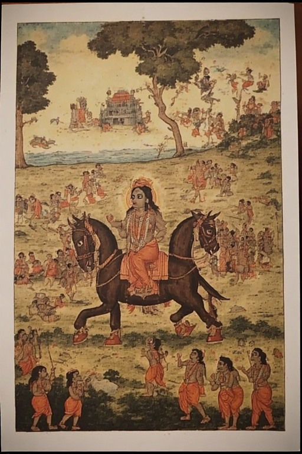



There is a peculiar kind of crisis that doesn't announce itself with collapse. No walls fall. No war is declared. The streets look normal. And yet something vital is gone — not defeated, simply absent. This is roughly the condition of Hindu civilizational identity today. The question worth asking isn't why it's under threat. It's why so many attempts to revive it seem to go nowhere.



## <u>The Head is Gone</u>

For most of history, Hindu society had a layered architecture of authority. Brahmin scholars maintained the intellectual and spiritual tradition. Kings enforced dharmic order as a state project. Monastic institutions — the maths, the shankaracharyas, the wandering orders — formed the connective tissue between high philosophy and everyday life. Together they constituted something like a central nervous system. The temple, the court, the ashram, the village — each reinforced the others.

That system no longer exists in any coherent form. The brahmin intellectual establishment was dismantled, first socially and then institutionally. The kings are gone. And the post-independence state positioned itself explicitly as secular — meaning Hindu civilizational logic has no formal home in governance. It is at best a cultural mood, at worst an electoral demographic.

What remains is a body without a head. Millions of people nominally Hindu, carrying fragments of ritual and feeling, but with no authoritative voice to follow, no institution to belong to, no structure that commands genuine loyalty. Whenever someone attempts reform or revival, the first response is not engagement but suspicion: *who are you, exactly? This is not my Hinduism.* The critique isn't even wrong — there genuinely is no institution empowered to speak for the whole. The decentralization that once made the tradition resilient now makes collective action almost impossible.

This is the leadership crisis. It is real, and it matters. But it is not the deepest problem.

---

## <u>The Peasant Argument</u>

The awareness campaigns haven't cracked this. Videos, essays, podcasts about demographic change and civilizational stakes — they circulate in the same circles and rarely convert anyone. Part of the reason is a category error: the people making the case are addressing an argument that most ordinary people simply aren't having.

There is a strain of thought, very deep and very widespread in India, that might be called the peasant argument. It goes something like this: *life will continue regardless. Whatever system prevails, I will adapt. I have always adapted. If things change, I'll change with them. Khana peena chalega.* It is not cynicism, exactly. It is a kind of radical passivity — a very old survival instinct in a society that has been conquered and reconquered across centuries.

For someone operating from this framework, warnings about demographic shift or cultural erosion are not wrong — they are simply irrelevant. The future being described is not frightening to them. People live in Pakistan. People live in Bangladesh. Life goes on. The awareness warrior is answering a question the peasant never asked.

This is not secularism in the ideological sense. It is something more primordial: the absence of a self strong enough to feel threatened.

This is a much harder problem than ignorance. You can educate the ignorant. You cannot easily argue someone out of a posture toward life.

---

## <u>The Illusion of Inherited Culture</u>

Compounding this is an assumption almost universally held but rarely examined: that being born Hindu means you possess Hindu culture. That the *virasat* is automatic, embedded in blood and name.

It isn't. Culture is practiced, not inherited. It requires transmission — through institutions, through teachers, through community structures that repeat and reinforce values across generations. When those structures weaken or disappear, the content drains away even as the label remains. What's left is a very thin skin: people who identify as Hindu, who may feel vaguely that it matters, but whose actual inner lives have been shaped by entirely different forces — secular education, market individualism, Western popular culture, or nothing coherent at all.

This is not a moral judgment on individuals. It is a structural observation. The thinness of the culture is the predictable result of a century of dismantled institutions, not a personal failing. But it means that the common assumption — *of course Hindus will defend Hindu civilization, they are Hindus* — is far shakier than it appears.

What makes this worse is that the blank slate is not only the result of institutions failing from above — it is also manufactured at home, from below, one childhood at a time. The same Hindu parent who genuinely cares about civilizational continuity will spend eighteen years telling their child that all religions are equal, all paths lead to the same god, everyone is the same. It is a generous instinct. It also systematically dismantles any basis for the child to feel that their particular inheritance is worth protecting. Then, when the child grows up and acts on exactly what they were taught — when they marry across a line, or drift away, or simply feel no particular pull toward anything Hindu — the same parent is baffled and wounded. But the surprise is unearned. You cannot spend two decades telling someone that all things are equivalent and then be shocked when they treat all things as equivalent. The blank slate, in many cases, was not an accident of modernity. It was the direct product of a confused piety that confused tolerance with indifference, and paid for it a generation later.

---

## <u>The Literacy Trap</u>

Universal literacy was supposed to solve part of this. The theory was that once a man could read, he could think — could weigh evidence, form independent judgements, hold his government accountable. What it actually produced, as the twentieth century made clear, was a population more efficiently susceptible to mass messaging. People read, but mostly they receive. The mind that literacy was supposed to liberate became instead a surface on which organised opinion could be printed at scale. Democracy deepened this problem by making the existing system feel like the only conceivable one.

The implication is uncomfortable: information alone is not a lever. And neither is moral urgency. A blank slate gravitates toward power. Whoever looks most powerful and useful will attract those who have no strong alternative center of gravity. You cannot alarm someone into caring about a future they cannot visualize.

---

## <u>What the Missionaries Understood</u>

Here is something that the RSS and its affiliated ecosystem have never adequately addressed: Christianity and Islam do not spread primarily through theology. They spread through structure.

The missionary hospital with the cross on the wall. The church that is also a community center, a school, a network of mutual employment and social belonging. The mosque that is a neighborhood anchor, a source of legal counsel, financial solidarity, and brotherhood. These are not incidental features — they are the core of the offer. The religion is the guild.

The conversion calculus for most people is not theological — it is social. You get something. You belong somewhere. For the person without a strong internal compass, individual philosophical freedom is useless. They need a network. They need bread. They need to matter to someone. And right now, Hinduism — with its genuine philosophical sophistication and its very real institutional vacuum — is losing this competition badly.

Hindu temples, collectively, sit on extraordinary resources. Land, gold, revenue, institutional presences going back centuries. In principle, they could fund hospitals, schools, welfare networks — a genuine social infrastructure that makes being Hindu materially meaningful in everyday life. But those trusts mostly operate with a small, token idol in a corner while the rest of the institution runs like a government office. And this is not an accident. The state controls most major Hindu temples — their revenues, their appointments, their decisions. The Supreme Court has upheld this arrangement. The irony is stark: Hindu temples are the single institution that could provide the structural backbone the tradition desperately needs, and they are precisely the institution kept on the tightest leash.

---

## <u>The Chicken and the Egg</u>

A reasonable objection: even if temples were free, would it matter? Culture isn't just infrastructure. People with baseline survival needs often adopt whatever ideology comes packaged with power. They became communist. They became American. They became Christian. Wealth alone doesn't create civilizational loyalty — wealthy Indians have often been the first to drift furthest from any indigenous framework.

This is true. And it points to the deeper problem, which is genuinely circular. Civilizational self-belief generates power. Power attracts followers and resources. Resources build institutions. Institutions transmit and reinforce the self-belief. But to enter this cycle, you need to already be somewhere on it. You need a core — a group that is visibly confident, visibly capable, visibly elite in the best sense of the word — that makes the identity look like something worth having.

This was historically the function of the sadhu and the vedic scholar: not just to preserve knowledge, but to embody a visible alternative to worldly power. An aesthetic of mastery that money and politics couldn't replicate. That archetype still exists but has been so thoroughly marginalized that it no longer shapes the aspirations of ordinary people.

What's needed is not revival of the past form, but recovery of the function. A genuine core that is creative, productive, internally coherent, and expanding outward — not through conversion drives, but through demonstrated excellence that makes people want to be inside the tent.

---

## <u>The Problem with the Current Occupants</u>

The space that such a movement would need to occupy is currently held — loosely, ineffectively, but held — by the RSS and BJP.

The RSS has real numbers and real reach. But its intellectual and cultural production has stalled into a kind of patriotic boomerism: shakhas, flags, Bharat Mata, the same rhetorical loops on repeat. It is not generating original thought, original institutions, or original prestige. It is a holding pattern. For a new Hindu organisation to grow, it must operate in a field that the RSS has already crowded without fertilising. This is not a small problem. It's the difference between an ecosystem with room for new growth and one where all the light has been taken by a tree that isn't bearing much fruit.

BJP, meanwhile, operates as an electoral machine. Its strategic theory seems to be: *stay in power long enough and gravity will do the work.* Power will bend institutions, culture will follow politics, and the Hindu moment will arrive through accumulated dominance rather than deliberate construction. The problem is that this theory requires you to actually use power while you have it — and the BJP has largely spent its symbolic tokens. The Ram Mandir was the last great spend. What follows has been incremental, compromised by coalition management, and increasingly disconnected from any coherent civilizational vision. The party makes alliance calculations that would have been unthinkable a decade ago, and the ideological clarity that gave it its initial energy has quietly eroded.

The risk is not that these institutions are hostile. It's that they are occupying the space without filling it, making it harder for something genuinely new to emerge around them.

---

## <u>Demand Before Supply</u>

History suggests this kind of problem tends to resolve in one direction: demand precedes supply. The leader, the movement, the institution does not appear first and then generate followers. The followers — or at least a critical nucleus of them — develop a genuine appetite, a real frustration with what exists, a readiness to follow something better. Then something emerges to fill that vacuum.

The nucleus exists. It has been growing, quietly, for years. The awareness is real, even if imperfect. The dissatisfaction with existing institutions is real and growing sharper. What's missing is not awareness but architecture — the organizational forms, the cultural content, the institutional presence that can aggregate dispersed individuals into something with weight and momentum.

That architecture won't come from parties or from any single charismatic figure. It will come from the gradual accumulation of serious people building serious things — schools, publications, temples with genuine autonomy, cultural institutions, professional networks — under a shared sense of purpose.

The civilization is not dead. But it is behaving like a headless body, still warm, waiting for something to tell it where to go.

---

*The question is not whether a new center of gravity will emerge. It is whether it emerges before the blank slates fill up with something else.*
