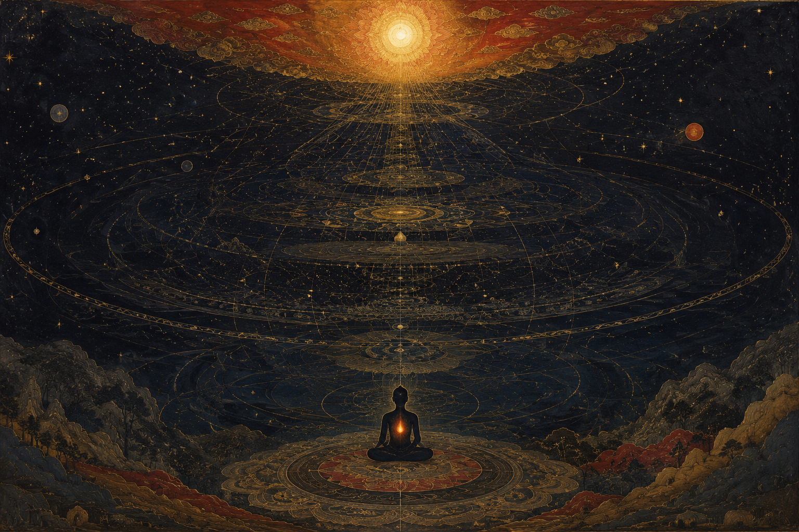



There is a phenomenon almost everyone has experienced but few have named cleanly. Spend five hours in an environment of pure stimulus — surrounded by people who react rather than reflect, who operate on appetite rather than thought — and you return from it diminished. Not tired, not bored, but *degraded* in some specific way. The texture of your thinking coarsens. The reflective life recedes. You feel, to put it plainly, more animal.

The ancient Sanskrit word for the opposite of this process is *shuddhi* — purity. Not ritual purity, not the purity of bodily cleanliness, but the purity of the *atma*. Of the soul. The sustained effort to keep that inner faculty intact, unmuddied, capable of genuine philosophical life. And this concept can fairly be called the actual root from which the entire philosophy of *varna* grows — a root so thoroughly buried under centuries of its own corruption that most people today cannot locate it at all.



## <u>The Soul Before the Occupation</u>

*Varna* is almost universally discussed as a social or economic system: a division of labor, a hierarchy of occupations, at worst a mechanism of oppression enforced by birth. What it is almost never discussed as is what it originally was — a taxonomy of *soul-types*.

The distinction matters enormously. A Brahman, in the original philosophical sense, is not a man born to a particular family. A Brahman is a *soul of a particular character* — one that has cultivated purity of thought, detachment from the world of mere stimulus and reaction, and a deep orientation toward the philosophical and the universal. The *Brahman pravriti* is an inner quality before it is a social category. Similarly, the Kshatriya quality is an orientation of will toward duty and protection; the Vaishya toward enterprise and sustenance. These are not costume categories. They are descriptions of something genuinely real about the distribution of human dispositions.

This is also precisely what the Gita says. In one of its central verses, Krishna states that the four varnas were created by him through the division of *guna* and *karma* — disposition and action — not through birth. The classification he describes is one of inner quality and conduct; the criteria are internal and earned, not external and inherited.

---

## <u>What the Mahabharata Says About Itself</u>

Here is where the story gets philosophically interesting. The Shanti Parva — the longest of the parvas, comprising Bhishma's deathbed discourse to Yudhishthira as he lay on his bed of arrows, delivering everything he knew: philosophy, politics, governance, war, religion — contains within it a remarkable internal debate on the very question of varna.

The sage Bharadwaja challenges Bhrigu's account of varna by appealing to a common humanity: every shade of complexion shows up across every group, every group feels the same hunger, fear, grief, and affection, and every person enters and leaves the world through the same biological process. Given all that, he asks, what actually justifies treating the castes as fundamentally distinct?

Bhrigu concedes the point: the castes carry no essential difference of nature; what separates them is simply a division of labor, and nothing in that division bars any group from its duties or its rites of passage. The Anushasana Parva carries the same conclusion further, holding that a person's worth rests on neither lineage nor ritual initiation nor inherited status nor accumulated learning, but on conduct alone — on the qualities and virtues a person actually demonstrates in life.

This is the Mahabharata's own position on itself. Not a reformist revision from outside, not a modern liberal interpolation — the text's own internal argument. The edifice contains its own philosophical foundation right there in the longest parva, visible to anyone willing to look.

---

## <u>The Product of Kaliyug</u>

The question then is obvious: if this was always the philosophical foundation, where did the rigid, birth-based, hereditary system that actually exists come from?

The Hindu framework offers its own answer. Kaliyug — the age of deterioration — is precisely the era in which forms lose their philosophical content and calcify into empty shells. The *varna* system was designed to organize society around genuine soul-qualities, assessed over lineages and expressed through gunas and karma. It functioned when it was responsive to that reality. It became unrecognizable — it became the thing it was never meant to be — when the powerful corrupted it into an instrument of domination, using it to oppress exactly the people it was meant to serve.

What we inherited, in other words, is not varna. It is varna's Kaliyug corruption. And the tragedy of the modern conversation — which is almost entirely a reaction to this corruption, not to the original idea — is that by fighting the corruption, it has also buried the original beneath it. The form and the spirit get discarded together, and what replaces them is neither the original wisdom nor a coherent alternative.

---

## <u>Stratification Is Real; the Brahman Ideal Is Universal</u>

This is the tension any honest engagement with these ideas has to hold simultaneously.

On one side: genuine stratification of soul-disposition exists. Different human beings are genuinely at different points in their development — philosophically, in their orientation toward the examined life, in their relationship to pure stimulus versus reflective thought. The observation that mixing indiscriminately in the domain of philosophy has real costs for the philosophical mind is not bigotry. It is an observation the tradition makes consistently, and one that daily experience confirms. The concept of shuddhi is a genuine response to a genuine phenomenon. Guard what enters the *atma*, because environment is not neutral and what surrounds you shapes what you become.

On the other side — and this is the other half of the same tradition — only *Paramatma* is truly higher. The light that animates all of us is the same light. The Gita says it; the Aghori tradition reaches the same conclusion from the opposite direction. And therefore the Brahman ideal is not the hereditary property of any jati, any community, any bloodline as it currently stands. It is the *telos* — the proper end — of a human being from any starting point.

From Arjuna down to Sudama. From the warrior to the cowherd, from anyone in any sphere of life. The aspiration is identical: *become Brahman.*

---

## <u>The Goal and Its Inheritance</u>

So what does this leave us with? A practical thesis, actually — and a demanding one.

The best a human being can do — in any era, from any starting point, regardless of what Kaliyug has done to their lineage or their social position — is to orient the entire project of their life toward the Brahman ideal. Purity of thought. Purity of soul. Purity of karma. And crucially: enforce it. Not just in one's own life, but in the philosophy transmitted, in the dispositions cultivated, in the principles that become the inheritance of the next generation.

This is not achieved in a single lifetime in its fullness. It accumulates. It compounds across generations — in bloodlines, in the philosophies that are passed down, in the *vansh* as a living carrier of ideas and character. Heritage and legacy are powerful precisely because they were built over centuries. The gap between a mind cultivated over many generations and one beginning now cannot close in a single generation — not because the soul-potential differs, but because compounding takes time. This is not fatalism. It is an argument for *beginning*. For starting the churning now, and trusting that it accumulates.

The Kaliyug ends. Every cycle does. What the tradition says will survive into the next Satyug is not the corruption, not the rigidity, not the oppression — all of that belongs to the cycle and ends with it. What survives is the karma. The actual philosophical content of actual lives, actually lived. The bloodlines and thought-lineages that maintained genuine *Brahman pravriti* through the darkness are the ones that carry forward into the light.

That is the complete theory. It is, in the end, as demanding as any philosophy can be — not a comfort, not a justification for present hierarchies, but a call placed equally on every individual regardless of birth: find your way to the examined, pure, philosophical life. Begin the compounding. The ladder was never hereditary. It was always available. It is available now.
